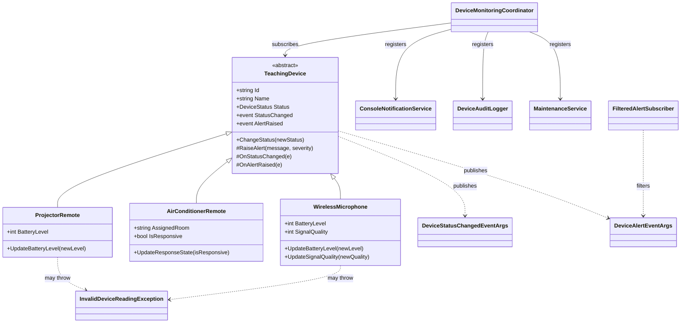

# Thiet ke W08 - Delegate va Event

## Publisher va subscriber

- Publisher: `TeachingDevice` va ba lop dan xuat `ProjectorRemote`, `AirConditionerRemote`, `WirelessMicrophone`.
- Subscriber: `ConsoleNotificationService`, `DeviceAuditLogger`, `MaintenanceService`; `FilteredAlertSubscriber` nhan canh bao qua delegate loc.
- `DeviceMonitoringCoordinator` quan ly dang ky va huy dang ky cho ba subscriber chinh.

## Event va du lieu di kem

- `StatusChanged` dung `EventHandler<DeviceStatusChangedEventArgs>`; du lieu gom `DeviceId`, `OldStatus`, `NewStatus`, `ChangedAt`.
- `AlertRaised` dung `EventHandler<DeviceAlertEventArgs>`; du lieu gom `DeviceId`, `Message`, `Severity`, `OccurredAt`.
- `DeviceStatus` bieu dien trang thai thiet bi; `AlertSeverity` bieu dien muc do canh bao.

## So do lop chinh

## Quan he va quyet dinh thiet ke

`TeachingDevice` dong goi `Status` va cong bo event qua `EventHandler<TEventArgs>`; cac lop con chi phat hien thay doi rieng cua minh va goi `RaiseAlert`. Coordinator noi publisher voi subscriber bang dang ky event, con subscriber khong sua truc tiep du lieu thiet bi. Cac danh sach log va yeu cau chi doc duoc tu ben ngoai.

1. **Vi sao `TeachingDevice` khong goi truc tiep `MaintenanceService`?** De lop thiet bi khong phu thuoc vao lop dich vu cu the. Event cho phep nhieu subscriber doc cung mot thong bao va co the bo sung subscriber ma khong sua publisher.
2. **Khi nao dung event chung, khi nao can event rieng?** Dung `AlertRaised` chung khi cac loai canh bao co cung du lieu can thiet (`DeviceId`, noi dung, muc do). Dung event rieng khi hanh dong hoac du lieu cua su kien khac ban chat, nhu `StatusChanged` so voi canh bao.
3. **Thanh phan nao co quyen phat sinh event?** `TeachingDevice` va cac lop dan xuat phat sinh event thong qua cac phuong thuc `protected`. Ben ngoai chi duoc dang ky hoac huy dang ky handler.
